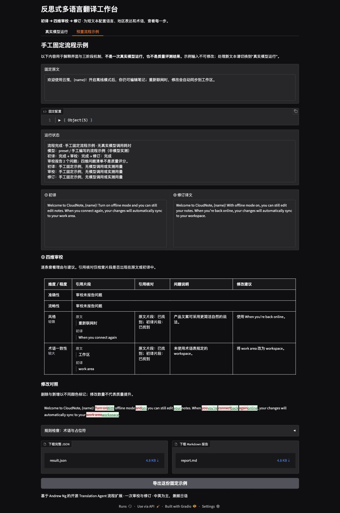
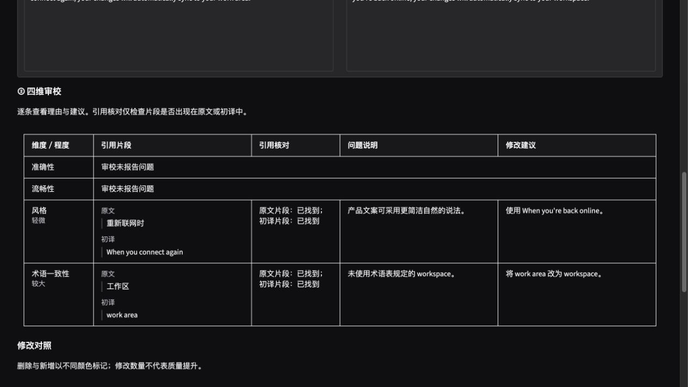

# 多语言反思翻译 Agent

基于 Andrew Ng 的 Translation Agent 原型，将“初译—审校—修订”做成可运行、可追踪的短文本翻译工作台。支持兼容 Chat Completions 的模型服务及本地 Ollama；中文 Gradio 界面与 CLI 共享同一流程。

## 界面预览

以下截图来自平台的“预置流程示例”，内容为手工预置，展示初译、四维审校、修订对照和报告导出。

**平台工作台**



**四维审校与引用核对**



## 快速启动

需要 Python 3.12 和 uv。在本目录执行：

```bash
UV_CACHE_DIR=.uv-cache uv sync --locked
test -f .env || cp .env.example .env
UV_CACHE_DIR=.uv-cache uv run translate-agent ui
```

打开 [本机界面](http://127.0.0.1:7860)。默认只监听本机，不创建公开分享链接。`uv sync` 会建立本项目的 `.venv`；不会安装到系统 Python。项目缓存位于 `.uv-cache`，所有依赖由 `uv.lock` 锁定。

## 模型配置

### 本地 Ollama

先启动 Ollama 桌面应用，或在独立终端执行 `ollama serve`。检查本地模型：

```bash
ollama list
```

本机已有 `gemma3:1b`，可直接用于流程验证。在其他机器上若没有该模型，可自行执行 `ollama pull gemma3:1b`。项目不会自动下载模型。

默认 `.env` 配置如下，可替换为本机其他支持聊天的模型：

```dotenv
OLLAMA_BASE_URL=http://127.0.0.1:11434
OLLAMA_MODEL=gemma3:1b
OLLAMA_NUM_CTX=16384
LLM_TIMEOUT_SECONDS=120
MAX_OUTPUT_TOKENS=4096
```

`gemma3:1b` 用于检查本地调用和完整工作流，是否适合实际翻译需依据自己的样例评估。若内存或上下文限制导致调用失败，界面与报告会保留已完成阶段。

### 兼容 Chat Completions 的服务

在项目根目录的 `.env` 填写服务商提供的配置，然后在界面选择 `compatible`，或在 CLI 传入 `--backend compatible`：

```dotenv
API_BASE_URL=https://your-provider.example/v1
API_MODEL=your-model-name
API_KEY=your-api-key
API_RESPONSE_FORMAT=none
```

`API_BASE_URL` 填接口前缀，不包含末尾 `/chat/completions`。进程环境变量优先于 `.env`。密钥不进入界面、运行元数据或导出报告，`.env` 已被忽略。

默认 `API_RESPONSE_FORMAT=none` 通过提示词要求审校 JSON，并在本地校验；服务商明确支持时可设为 `json_object` 或 `json_schema`。这些设置只影响审校阶段。兼容协议并不保证所有服务商都支持完全相同的模型参数；真实服务需用自己的地址、模型和凭据验证。

## 界面演示

“真实模型运行”中选择验证案例，或粘贴自己的短文本；配置语言、地区、风格、术语表和后端后开始翻译。界面依次显示初译、四维审校、修订及修改对照，完成后可下载 JSON 和 Markdown。

“预置流程示例”是独立的、手工编写的固定演示，用来说明如何从问题建议得到修订。它不调用模型、没有实测耗时或 token 用量，只接受配套固定输入；真实调用失败不会切换到示例。

首版只处理不超过 2,000 字符的短文本，不截断超限输入。默认只做一轮审校修订；审校无问题时保留初译，修订状态显示“无需修订”。

## 命令行

### 单条翻译

```bash
UV_CACHE_DIR=.uv-cache uv run translate-agent translate \
  --text '客户端应为每次请求生成幂等键，避免重复创建订单。' \
  --source 中文 --target English --locale en-US \
  --style '简洁、准确的技术说明' \
  --backend ollama --model gemma3:1b \
  --output artifacts/translations
```

`--glossary` 可传入 JSON 文件路径，格式为 `{"幂等键":"idempotency key"}`。`--text-file` 可替代 `--text` 读取 UTF-8 纯文本，仍受相同长度限制；没有 Word/PDF 解析或排版还原功能。

运行成功时标准输出为修订译文，报告路径写入标准错误。每次翻译写入 `--output/<run_id>`，不覆盖以前的运行。返回码 `0` 表示完成、`1` 表示模型流程失败且已保存部分结果、`2` 表示配置、参数或文件读写错误、`130` 表示用户中断。导出失败时，已完成译文仍输出到终端。

### 配对验证

```bash
# 全部 12 条案例，额外加入同源英美地区对照（共 14 条）
UV_CACHE_DIR=.uv-cache uv run translate-agent evaluate \
  --backend ollama --locale-pair --output artifacts/evaluation

# 先验证单个案例，避免一次发起整组调用
UV_CACHE_DIR=.uv-cache uv run translate-agent evaluate \
  --backend compatible --case en-zh-technical
```

每条案例通常调用模型三次；审校无问题时为两次，审校格式错误时最多额外纠正一次。运行整个案例集会产生相应模型请求与费用。

内置案例由本项目自编，覆盖中英、中日双向各三个场景：产品文案、商务沟通、技术说明。它们是演示和回归输入，不是公开基准，也不附带预设质量结论。英美对照使用相同原文，仅改变地区配置。

每次评估创建独立的 `evaluation-<uuid>` 目录，包含：

- 每例的初译、四维审校、修订、生成配置、阶段耗时及实际返回的 token 用量。
- `summary.json` 与 `summary.md`：执行状态与逐例记录索引。
- `manual-review.md`：随机顺序的 A/B 译文及四维人工评审表。
- `blind-mapping.json`：A/B 对应初译或修订的映射，评审后再打开。

评估按阶段更新每例 `checkpoint.json`，并原子更新批次汇总。审校期间按 Ctrl+C，已经完成的初译仍可查看，未完成案例不会被标为成功；需要继续时用 `--case` 重新运行该案例。报告导出失败会停止后续模型调用，已保存结果保留。

术语检查只统计原文出现的术语是否在译文中按字面命中；占位符检查保留原样和出现次数。审校引用核对标明引用片段是否能在原文、初译中找到，空片段记为“未提供”，不会自动删除意见或改变译文。规则用于定位具体变化，不代表整体质量。未返回的 token 用量保持为空。人工评审可得出“修订更好／相当／初译更好”，不预设修订优于初译。步骤见 [人工评审说明](docs/manual-review.md)。

## 实现与来源

核心接口为 `translate(request, client) -> TranslationResult`，UI、CLI 和评估脚本共享该接口。模型客户端通过轻量协议注入，没有导入模块即创建云端客户端的副作用。

上游 [andrewyng/translation-agent](https://github.com/andrewyng/translation-agent) 已包含初译—反思—修订流程，以及准确性、流畅性、风格、术语四维提示词。本项目基于固定提交 `e0fc605acbb5d78cb7a58a98bc8bd8f0056df49c` 移植并扩展，不将这些已有设计声称为原创。

本工程新增结构化审校、跨阶段地区与术语配置、两个模型后端、中文可视化、完整阶段记录和配对验证。没有把旧版上游包作为运行依赖。MIT 许可和原版权见 [来源与许可](THIRD_PARTY_NOTICES.md)，实现结构见 [架构说明](docs/architecture.md)。

当前不含 Dify/Coze 流程、长文分块、文档上传、数据库、账号或公网部署配置。简历中涉及低代码的部分不属于本次交付。

## 测试与实际验证

```bash
UV_CACHE_DIR=.uv-cache uv run pytest -q
UV_CACHE_DIR=.uv-cache uv run ruff check .
```

测试覆盖阶段输入传递、配置传播、无问题跳过修订、结构纠正与失败保留，以及两个后端的协议、错误和用量解析。固定样例测试与 HTTP 模拟测试不被计入真实模型效果。

本机真实运行、界面验收及云端实测状态记录于 [实际验证记录](docs/verification.md)。没有配置云端凭据时，云端状态应为“适配器测试通过，真实服务待验证”。

后续工程修复与20次本地提示词对照见 [并行迭代记录](docs/parallel-iteration.md)。该候选未改善结果，当前仍使用 `v1-json`；新的真实运行会记录提示词版本，旧结果保持“未记录”。
