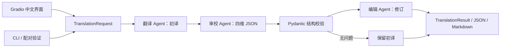

# 架构与提示词

## 数据流

三个 Agent 是不同提示词和职责的逻辑角色，默认共用同一个模型，并非三个独立模型或自主联网代理。流程执行一轮审校修订；格式纠正最多一次，不进行无界循环。

## 公共类型

- `TranslationRequest`：原文、源语言、目标语言、地区、风格、术语映射。原文长度为 1–2,000 字符，纯空白无效。
- `ReviewReport`：`accuracy`、`fluency`、`style`、`terminology` 四组问题。每项包含对应维度、原文与译文片段、原因、建议和严重程度。无问题的维度仍返回空列表。
- `TranslationResult`：请求、初译、审校、修订、整体状态、后端与模型、公开生成配置、时间、每阶段状态及逐次调用记录。
- `prompt_version`：新运行记录实际提示词版本；历史结果缺失时为 `null`，不回填推测版本。
- `LLMClient.complete(messages, schema=None)`：返回文本与实际用量。兼容服务和 Ollama 各自处理协议，核心工作流不依赖具体 HTTP 结构。

## 三阶段约束

初译关注语义保真、自然表达和用户给出的地区、风格、术语要求。审校同时读取原文与初译，提供可落实的修改建议，说明默认使用中文。编辑读取原文、初译和已通过校验的审校意见，按建议修订，避免无依据扩写。

源语言、目标语言、地区、风格及术语要求传入全部阶段。原文和译文作为内容数据交给模型，不作为系统级指令。术语目标译法与地区配置冲突时应在审校中指出具体问题；本项目没有预设的机器质量总分。

审校严格校验为完整 JSON，可接受外围单个 JSON 代码围栏，不从任意自然语言回答中截取一段“看似 JSON”的内容。第一次解析失败时保留原输出、错误和耗时，再要求纠正一次；第二次仍失败则终止。成功解析不代表审校内容本身一定正确，需要人工核对。

## 后端与运行记录

兼容服务调用 `/chat/completions`；Ollama 调用 `/api/chat` 并关闭协议级流式响应，审校使用 JSON Schema。界面按阶段完成情况更新，而非逐 token 渲染。

未完成阶段保持可识别的状态。连接失败、超时、鉴权错误、空输出或截断不会被标为成功；后续阶段不继续执行，已经完成的文本仍可导出。审校无问题时将修订标为跳过，输出保留初译。

耗时来自真实调用计时；用量来自服务响应。多次调用中某次用量缺失时，聚合用量保持未知，不将其伪装为零。固定示例没有模型调用记录，示例时间仅是编写标签。

导出只包含请求、生成结果和公开元数据，不序列化客户端或密钥配置。用户主动输入到原文的内容仍属于报告内容。没有数据库；报告写入本地 `artifacts`，可按需保留或删除。

批量评估利用 `on_progress` 保存每阶段快照，在下一次模型调用前保留已完成文本。`checkpoint.json` 与批次 `summary.json` 以临时文件替换方式更新；中断重新抛出并由 CLI 返回130，磁盘错误则停止后续调用。流程状态与报告导出状态分别记录，导出错误不会把已完成翻译改为模型失败。

报告派生字段 `rule_checks.review_evidence` 只对审校引用做字面核对；空引用、缺少初译与确实未找到分别记录。它不参与编辑决策，也不修改历史意见。界面以“流程完成”描述执行结果，并按屏幕宽度切换表格或卡片，完整保留修改建议。

## 与上游的关系

上游三阶段、四维提示词和地区表达思想被保留并扩展。新实现不直接依赖上游旧客户端初始化方式，不采用其长文分块算法；当前范围仅为短文本。新增结构化类型、后端适配、界面、观测与评估代码由本工程提供。固定来源与 MIT 全文见根目录 `THIRD_PARTY_NOTICES.md`。
