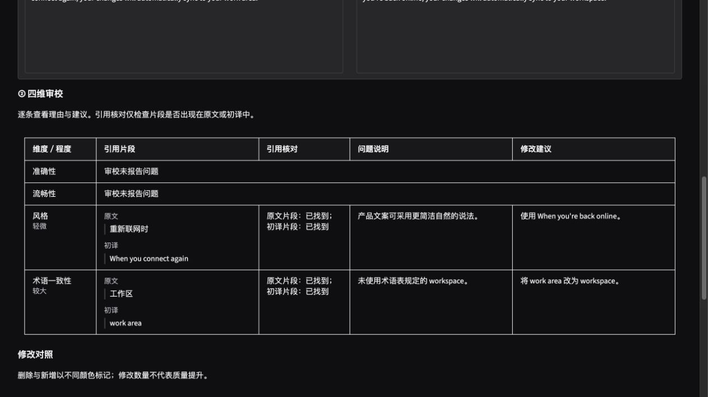

# 并行迭代记录

2026-11-03：在首轮交付基础上，并行推进工程可靠性、报告与界面、真实提示词对照。当前生产提示词仍为 `v1-json`。

## 已合入的工程改动

- **评估中断保留阶段结果**：每次阶段更新保存 `checkpoint.json`，批次汇总原子更新。审校中断后仍能查看初译；汇总标记 `interrupted` 和当前案例，不把部分结果标为完成。
- **导出失败与模型失败分开**：批次导出失败后停止后续调用；当前结果和已完成记录可恢复。界面继续保留译文和实际阶段状态，单独显示报告错误。
- **更早发现无效输出目录**：CLI 在创建模型客户端前检查目录。流程失败、配置/导出错误、中断分别返回1、2、130。
- **引用可核对**：四维意见展示引用是否出现在原文与初译中，空引用为“未提供”。保留原意见，不把未找到直接判为语义错误。
- **展示可读性**：总状态标为“流程完成”；宽屏表格和窄屏卡片完整显示修改建议，无问题维度使用紧凑行；真实运行记录提示词版本。

新增引用核对回查首轮14例中的有效审校记录：共12条意见，其中11条原文引用、5条初译引用未按字面找到。这是引用定位结果，不是翻译准确率。[原始运行的新版核对报告示例](../artifacts/review-evidence/local-smoke/report.md)保留旧时间与原始内容，未重新调用模型，也没有覆盖旧报告。

## 提示词对照：保留现行版本

共20次真实本地调用，使用已有 `gemma3:1b`，未下载模型或访问外部服务。4个诊断案例使用相同历史初译，对比现行与冻结候选的审校和编辑；另2个留出案例仅运行候选。编辑阶段使用明确标记的手工诊断建议，因此该试验不是端到端翻译效果测试。

| 诊断组 | 现行 | 候选 |
| --- | ---: | ---: |
| 首次审校结构通过 | 1/4 | 0/4 |
| 审校完整返回 | 4/4 | 1/4 |
| 审校耗时合计 | 23.138秒 | 87.023秒 |

候选仍遗漏14天和关键条件，并出现附加JSON、复制分隔符等输出。留出组审校1/2通过结构校验，没有稳定改进证据。未替换生产提示词，也没有把少量样本结果推广为模型整体能力结论。完整消息、配置、原始输出和分析见 [提示词对照结论](../artifacts/prompt-probe/decision.md)。

## 验证与复查

- 自动测试：122项通过；覆盖阶段中断快照、导出失败、引用状态、HTML转义、旧结果兼容等。
- Ruff 检查通过。
- 源码包与 wheel 构建通过，源码包包含提示词复查脚本；包内不含虚拟环境、缓存或本地 `.env`。
- 浏览器：检查默认宽屏完整审校表、600px窄屏卡片、引用核对及两种报告导出，验收后恢复默认视口。
- 外部云端仍未配置凭据，状态保持“适配器测试通过，真实服务待验证”。

提示词记录可离线重新汇总，不发模型请求：

```bash
uv run --no-sync python scripts/prompt_probe.py --summarize-only
```

该脚本默认锚定首轮评估目录；用 `--baseline-dir` 可显式指定包含对应历史案例的目录。运行全新试验时请将 `--output` 指向 `artifacts/prompt-probe` 下的新子目录，避免混入已有记录。



窄屏验收画面见 [600px预览](review-narrow.jpg)。
