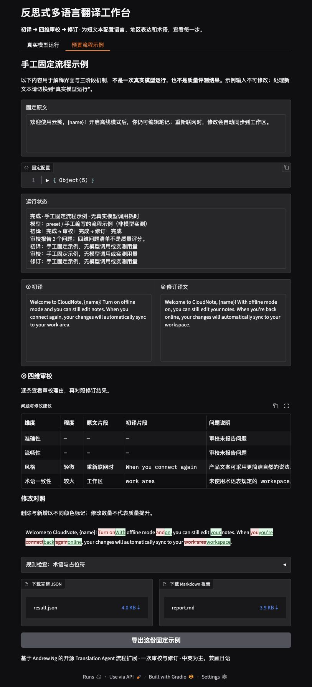

# 实际验证记录

验证日期：2026-11-03（Asia/Shanghai）。以下区分工程执行结果与模型翻译表现。

本页保留首轮实测记录；后续修复、当前122项测试及提示词对照见 [并行迭代记录](parallel-iteration.md)。

## 环境与自动检查

| 项目 | 实际结果 |
| --- | --- |
| Python | 3.12.13；项目独立 `.venv` |
| 依赖 | `uv.lock` 已生成；`uv sync --locked --offline` 成功 |
| 主要依赖 | Gradio 6.31.0、Pydantic 2.14.2、httpx 0.28.1 |
| 自动测试 | `pytest -q`：100 passed |
| 静态检查 | `ruff check .`：通过；排除环境与依赖缓存 |
| 打包 | wheel 构建成功，包含全部三个样例 JSON、MIT 及上游许可说明；不包含环境、缓存或 `.env` |
| 本地模型服务 | Ollama 0.30.10；模型 `gemma3:1b`；Apple M2 Pro / Metal |

测试覆盖流程与配置传递、编辑输入、无问题跳过、一次 JSON 纠正、失败保留、两个协议适配器、超时/鉴权/空输出/截断、界面更新、报告导出、术语及占位符检查、人工评审材料。测试使用替身和 HTTP MockTransport；测试数量不代表翻译质量。

## Ollama 原生接口实测

使用已有模型，无额外模型下载。生成配置为 temperature=0.2、max_output_tokens=4096、num_ctx=16384。服务仅监听 `127.0.0.1:11434`。

1. [首次完整三阶段运行](../artifacts/local-smoke/report.md)：初译、审校、修订均返回，逐次耗时与 token 用量保存在同目录 JSON。
2. [14 例配对运行汇总](../artifacts/evaluation/evaluation-2b7834bf-fabc-4c9a-8403-c3bba3023f57/summary.md)：12 条四语向案例加 2 条同源英美地区对照。运行于当日 09:16–09:18，13 例流程完成，1 例失败。
3. 13 个完成案例中，3 个实际执行编辑，10 个因审校未报告问题保留初译。3 个案例的审校经一次结构纠正后完成。
4. [失败案例 en-zh-business](../artifacts/evaluation/evaluation-2b7834bf-fabc-4c9a-8403-c3bba3023f57/en-zh-business/report.md)：审校生成达到 4096 token 上限而截断。流程停止，初译、原始截断输出和实际用量均保留；没有把它标为完成。

对应的 [人工 A/B 评审表](../artifacts/evaluation/evaluation-2b7834bf-fabc-4c9a-8403-c3bba3023f57/manual-review.md) 尚未填写，没有人工评测分数或整体提升结论。不要将 13/14 的执行结果解释为翻译准确率。

### 已观察到的模型问题

- 首次运行将“免费试用结束后，工作区保留 30 天”译为“Free trial expires after 30 days”，改变了时间关系；审校没有指出，修订只改动了句末标点。
- 审校提示要求中文说明，但该 1B 模型有时用英文填写原因与建议，或引用原文中不存在的片段。Schema 验证只保证结构，不能证明意见真实。
- [中译日产品案例](../artifacts/evaluation/evaluation-2b7834bf-fabc-4c9a-8403-c3bba3023f57/zh-ja-product/report.md) 的编辑输出变成了中文对话回复，未给出日文修订。这一模型行为完整保留在报告中。
- 英美地区对照均使用 `color`，本次 `en-GB` 配置未促使模型采用 `colour`。地区要求已传入，但模型执行不稳定。

这些结果表明本机小模型可用于验证接口和流程，当前输出不能作为可靠翻译或“反思提升质量”的证据。实际使用可切换模型，并在同一组案例上重新验证。工程没有用固定示例替代上述真实结果。

## 兼容接口与云端状态

兼容适配器的请求格式、用量、JSON 模式和异常路径测试已通过。另使用 Ollama 的本地 `/v1/chat/completions` 端点进行了真实协议联通验证，`API_RESPONSE_FORMAT=json_schema`：初译“Please save changes.”成功返回，审校经一次纠正仍未通过结构校验，正确终止并保留初译，见 [运行报告](../artifacts/compatible-local/17807866-e311-4aa7-ad6d-00c5501be349/report.md)。这次调用未访问云端。

当前没有配置外部服务地址、模型及密钥，因此**外部云端：适配器测试通过，真实服务待验证**。未对任何云端模型声称实测成功。

## 浏览器验收

在 `http://127.0.0.1:7860` 完成了实际点击验证：

- 载入产品文案案例，原文、语言、地区、风格和术语自动填入。
- 点击真实运行，观察到初译进行中、阶段结果更新和最终状态；该次无问题审校保留了初译，JSON 与 Markdown 下载入口均生成。
- 切换固定示例，确认输入不可编辑、固定示例标记明确，四维审校、整词差异和规则检查可查看。
- 导出固定示例，确认两种报告均生成；固定示例没有模型调用耗时或 token。
- 最终版本重启后重新加载，确认英文词级差异生效。

## 再次运行

在工程根目录执行 `uv run translate-agent ui`；Ollama 未启动时先运行 `ollama serve`。云端使用前在 `.env` 填入自己的配置。报告保存在 `artifacts`，可通过 README 中的命令重新生成，既有运行目录不会被覆盖。
